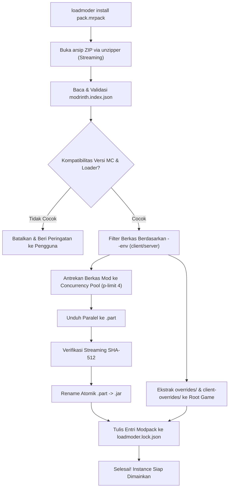
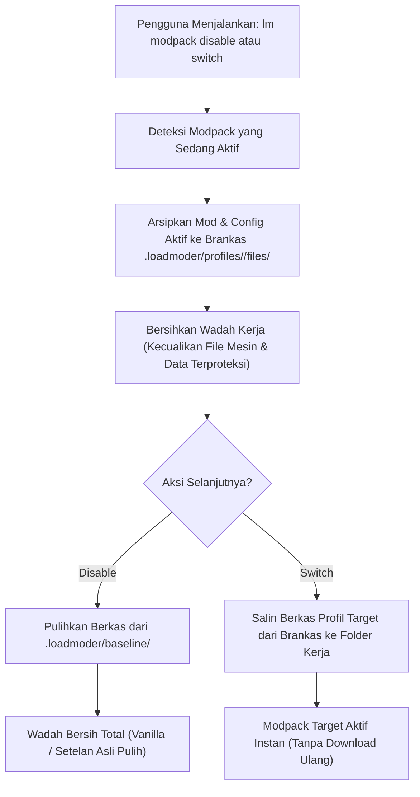

# 04: Mesin Modpack (.mrpack Engine)

Dokumen ini membedah spesifikasi format modpack resmi Modrinth (`.mrpack`), struktur manifes `modrinth.index.json`, arsitektur mesin ekstraksi, mesin ekspor modpack, serta sistem isolasi brankas profil pada LoadModer.

---

## 1. Anatomi Berkas `.mrpack`

Berkas `.mrpack` adalah arsip ZIP standar yang dirancang secara khusus untuk memisahkan **metadata dependensi** dari **konfigurasi lokal**, sehingga ukuran berkas modpack tetap sangat kecil (< 500 KB meskipun berisi 100+ mod).

```text
contoh-modpack.mrpack (Arsip ZIP)
├── modrinth.index.json         # MANIFES UTAMA (metadata, daftar mod, hash)
├── overrides/                  # BERKAS UMUM (diekstrak ke root game)
│   ├── config/
│   │   ├── sodium-options.json
│   │   └── minimap.txt
│   ├── resourcepacks/
│   │   └── default-dark-theme.zip
│   └── defaultconfigs/
├── client-overrides/           # BERKAS KHUSUS CLIENT (opsional)
│   └── options.txt
└── server-overrides/           # BERKAS KHUSUS SERVER (opsional)
    └── server.properties
```

---

## 2. Spesifikasi Skema `modrinth.index.json` (Format v1)

Berikut adalah struktur skema JSON lengkap beserta anotasi tipe TypeScript:

```typescript
export interface MrpackFileHash {
  sha1: string;
  sha512: string;
}

export interface MrpackFileEnvironment {
  client: 'required' | 'optional' | 'unsupported';
  server: 'required' | 'optional' | 'unsupported';
}

export interface MrpackFileEntry {
  /** Path relatif tempat file harus diletakkan (misal: "mods/sodium-fabric-0.6.0.jar") */
  path: string;
  hashes: MrpackFileHash;
  env?: MrpackFileEnvironment;
  /** Daftar mirror URL pengunduhan (Modrinth CDN) */
  downloads: string[];
  fileSize: number;
}

export interface MrpackIndex {
  formatVersion: 1;
  game: 'minecraft';
  versionId: string;
  name: string;
  summary?: string;
  files: MrpackFileEntry[];
  dependencies: {
    minecraft: string;
    'fabric-loader'?: string;
    'forge'?: string;
    'neoforge'?: string;
    'quilt-loader'?: string;
    [key: string]: string | undefined;
  };
}
```

### Validasi dengan Zod
LoadModer memvalidasi `modrinth.index.json` saat runtime menggunakan Zod untuk mencegah serangan path traversal (`../../`) dan file corrupt:

```typescript
import { z } from 'zod';

export const MrpackIndexSchema = z.object({
  formatVersion: z.literal(1),
  game: z.literal('minecraft'),
  versionId: z.string(),
  name: z.string(),
  summary: z.string().optional(),
  files: z.array(
    z.object({
      path: z.string().refine((p) => !p.includes('..'), {
        message: 'Path traversal tidak diizinkan dalam berkas mrpack',
      }),
      hashes: z.object({
        sha1: z.string(),
        sha512: z.string(),
      }),
      env: z
        .object({
          client: z.enum(['required', 'optional', 'unsupported']),
          server: z.enum(['required', 'optional', 'unsupported']),
        })
        .optional(),
      downloads: z.array(z.string().url()).min(1),
      fileSize: z.number().positive(),
    })
  ),
  dependencies: z.record(z.string()),
});
```

---

## 3. Alur Instalasi Modpack (Pipeline Ekstraksi)



---

## 4. Keamanan Streaming dan Sanitasi Ekstraksi

Setiap berkas dalam `overrides/` dan daftar `files` diekstrak menggunakan penjagaan ketat:

```typescript
export async function safeExtractEntry(
  entry: unzipper.Entry,
  targetDir: string
): Promise<void> {
  const normalizedPath = path.normalize(entry.path).replace(/^(\.\.[\/\\])+/, '');
  const destination = path.join(targetDir, normalizedPath);

  // Mencegah zip-slip path traversal di luar folder target
  if (!destination.startsWith(path.resolve(targetDir))) {
    entry.autodrain();
    throw new Error(`Deteksi upaya path traversal: ${entry.path}`);
  }

  if (entry.type === 'Directory') {
    await fs.promises.mkdir(destination, { recursive: true });
    entry.autodrain();
  } else {
    await fs.promises.mkdir(path.dirname(destination), { recursive: true });
    await pipeline(entry, fs.createWriteStream(destination));
  }
}
```

---

## 5. Ekspor Modpack (Modpack Exporter Engine)

Modul `ModpackExporter` (`src/core/modpack/exporter.ts`) memungkinkan pemain mengekspor instance Minecraft lokal yang sedang aktif ke dalam format `.mrpack` standar Modrinth atau arsip `.zip` mandiri.

### Antarmuka Opsi Ekspor
```typescript
export interface ModpackExportOptions {
  format: 'mrpack' | 'zip';
  instanceDir: string;
  outputPath: string;
  name: string;
  version: string;
  summary?: string;
  author?: string;
  gameVersion: string;
  loader: string;
  includeConfigs?: boolean;
}
```

### Mekanisme Kerja:
1. **Analisis Berkas Mods**:
   - Memindai folder `mods/` aktif pada instance.
   - Mengambil metadata hash SHA-1 dan SHA-512 untuk setiap file `.jar`.
   - Mengueri `loadmoder.lock.json` untuk mencocokkan `projectId` dan `versionId` resmi Modrinth.
2. **Pembuatan Manifes `modrinth.index.json`**:
   - Jika format target adalah `.mrpack`, sistem menyusun manifes valid format v1 berisi daftar unduhan resmi dari Modrinth CDN.
3. **Penyalinan Folder Konfigurasi (`includeConfigs`)**:
   - Jika opsi `includeConfigs` aktif, folder `config/` disalin ke direktori `overrides/config/` di dalam arsip ZIP dengan kompresi tingkat 9 via `archiver`.
4. **Integrasi Desktop GUI**:
   - Tersedia langsung melalui modal dialog `ExportModpackModal.tsx` di aplikasi desktop dengan opsi format, nama versi, dan pemilihan direktori output.

---

## 6. Arsitektur Brankas Profil Modpack (`ModpackProfileManager` & `BaselineManager`)

LoadModer mendukung isolasi modpack penuh untuk launcher berbasis wadah client terisolasi (seperti TLauncher dan Legacy Launcher).

### A. Struktur Direktori Brankas & Master Download

```text
<container_root>/               # TLauncher: versions/mypack/ | Legacy: game/home/Fabric-26.2/
├── .loadmoder/
│   ├── baseline/                                  # Master Baseline Satu Kali (Golden Snapshot)
│   │   ├── manifest.json                          # Metadata snapshot baseline
│   │   └── options.txt                            # options.txt asli sebelum tersentuh modpack
│   ├── downloads/
│   │   └── Zombie Apocalypse 1.1.mrpack           # Master .mrpack permanen
│   ├── profiles/
│   │   └── zombie-apocalypse-1-1/
│   │       ├── manifest.json                      # Metadata modpack & daftar berkas
│   │       └── files/                             # Arsip berkas (mods/, config/, options.txt, dll.)
│   └── active-profile.json                        # Pointer profil aktif saat ini
├── mods/                                          # Folder kerja aktif instance (hanya ada saat modpack aktif)
├── config/
├── options.txt                                    # Live options (dipulihkan dari baseline saat bersih)
├── saves/                                         # Dunia pemain (terlindungi in-place)
└── servers.dat                                    # Server multiplayer pemain (terlindungi in-place)
```

### B. Proteksi Berkas Mesin Launcher (`isPreservedEngineItem`)

Ketika wadah client dibersihkan saat menonaktifkan modpack (`lm modpack disable`) atau berganti modpack (`lm modpack switch`), LoadModer **tidak pernah menghapus seluruh folder wadah**:

* **TLauncher (`isTLauncherPreservedEngineItem`)**:
  * Direktori internal `.loadmoder/`
  * Direktori cache `.fabric/` (pada loader Fabric)
  * Folder `logs/`
  * Berkas konfigurasi launcher: `TLauncherAdditional.json`
  * Berkas engine game: `<containerName>.jar`, `<containerName>.json`
  * Seluruh berkas berekstensi `.jar` atau `.json` yang berawalan nama wadah (misal `mypack*.*`)
* **Legacy Launcher (`isLegacyPreservedItem`)**:
  * Direktori internal `.loadmoder/`
  * Direktori cache `.fabric/`
  * Folder `logs/` dan `saves/` (dunia pemain aman in-place)
  * Berkas `servers.dat` dan `servers.dat.bak`
  * Folder `server-resource-packs/`

### C. Sistem Cadangan Baseline Satu Kali (`BaselineManager`)

1. **One-Time Golden Snapshot (`createBaselineOnce`)**: Sebelum modpack pertama kali diekstrak ke wadah versi, LoadModer mengambil snapshot dari seluruh berkas & folder dasar (termasuk `options.txt` awal) ke dalam `.loadmoder/baseline/`.
2. **Permanent Master (Zero-Delete Policy)**: Folder `.loadmoder/baseline/` tidak pernah dihapus dan tidak pernah ditimpa ulang.
3. **Restorasi Bersih Otomatis (`restoreBaseline`)**: Saat modpack dinonaktifkan (`activeProfile: null`), wadah live dibersihkan dari modpack dan berkas baseline asli disalin kembali ke wadah, mengembalikan game ke kondisi awal pemain.

### D. Zero-Overwrite Active Modpack Guard

LoadModer secara ketat melarang penimpaan langsung saat modpack aktif di wadah yang sama:
* **`❌ Cancel` (Batalkan)**: Menghentikan proses unduh tanpa menyentuh disk sama sekali.
* **`🧹 Clean Install` (Bersihkan & Pasang Baru)**: Mengarsipkan modpack aktif ke `.loadmoder/profiles/<id>/`, membersihkan wadah live secara total, lalu memasang modpack baru secara bersih tanpa bentrok berkas sisa.

### E. Alur Kerja Brankas Profil: Switch & Clean State


