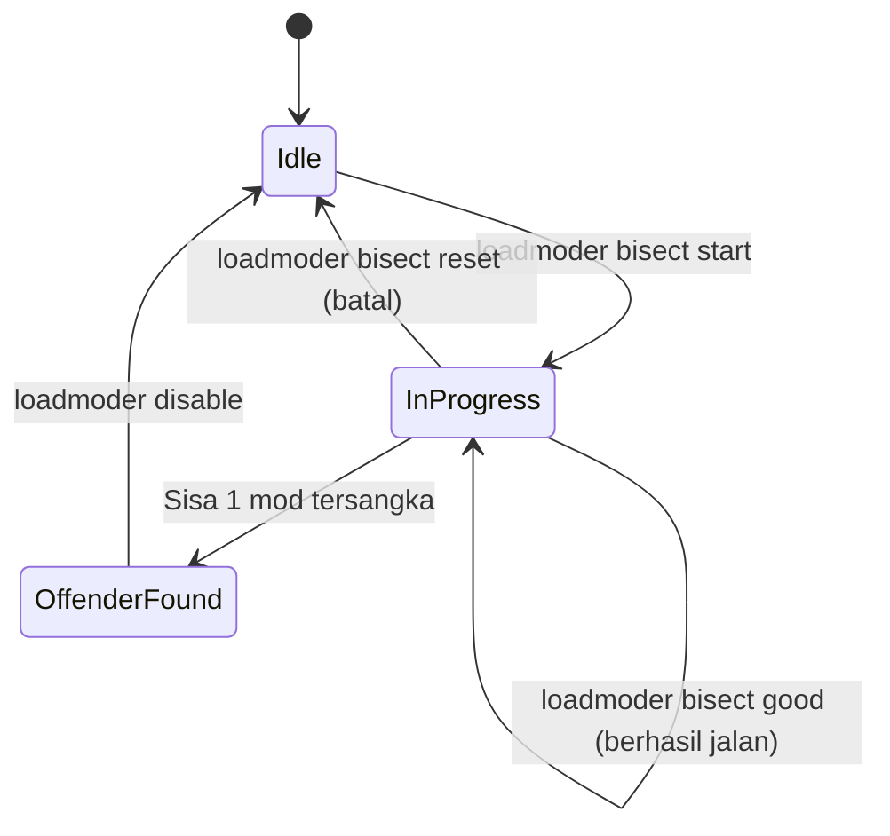

# 07: Diagnostik Crash, Bisect Engine dan Crash Log Analyzer

Dokumen ini mendokumentasikan alat pemecahan masalah bawaan LoadModer, mekanisme penonaktifan mod instan via ekstensi `.disabled`, Crash Log Analyzer otomatis, serta algoritma pencarian biner (**Automated Mod Bisect**) untuk mengisolasi mod penyebab crash.

---

## 1. Mekanisme Mod Disabler (`.jar.disabled`)

Semua mod loader (Fabric, Forge, NeoForge, Quilt) memindai folder `mods/` hanya untuk berkas yang berakhiran `.jar`. Berkas dengan ekstensi lain akan dilewati sepenuhnya.

LoadModer memanfaatkan karakteristik ini untuk mengaktifkan atau menonaktifkan mod secara instan tanpa menghapus berkas dari disk:
* `loadmoder disable optifabric` -> mengubah `optifabric-1.14.0.jar` menjadi `optifabric-1.14.0.jar.disabled`.
* `loadmoder enable optifabric` -> mengembalikan nama file ke `optifabric-1.14.0.jar`.

---

## 2. Crash Log Analyzer (`src/core/troubleshoot/logAnalyzer.ts`)

LoadModer v2.6.0 menyertakan mesin analisis log otomatis yang dapat memindai berkas `latest.log` atau `crash-reports/crash-*.txt` terbaru.

### Kategori Crash yang Didukung:
1. **Missing Dependency**:
   - Pola: `Mod '<id>' requires '<dep>'` atau `net.fabricmc.loader.impl.FormattedException`.
   - Tindakan: Menyarankan instalasi library yang kurang melalui Modrinth API.
2. **Incompatible Mod**:
   - Pola: `Mod '<id>' is incompatible with '<other>'` atau tabrakan Mixin (`org.spongepowered.asm.mixin.transformer.throwables.MixinTransformerError`).
   - Tindakan: Menyarankan penonaktifan mod yang berkonflik.
3. **Java Version Incompatibility**:
   - Pola: `has been compiled by a more recent version of the Java Runtime (class file version XX)`.
   - Tindakan: Memberikan panduan versi Java Runtime Environment yang sesuai.
4. **Out of Memory (OOM)**:
   - Pola: `java.lang.OutOfMemoryError: Java heap space`.
   - Tindakan: Menyarankan alokasi RAM (`-Xmx`) yang lebih tinggi pada launcher.
5. **Corrupted File**:
   - Pola: `ZipException: error in opening zip file` atau kegagalan pembacaan JAR.
   - Tindakan: Menyarankan pengunduhan ulang mod yang rusak.

### Integrasi Desktop GUI:
Pada aplikasi desktop, tab **Bisect & Log Analyzer** menyediakan tombol pemindaian log instan. Ketika crash terdeteksi, panel menampilkan ringkasan akar masalah, cuplikan stack trace relevan, serta tombol aksi cepat untuk menonaktifkan mod bermasalah dalam 1 klik.

---

## 3. Algoritma Automated Mod Bisect

Ketika sebuah modpack berisi 100+ mod dan game mengalami crash saat peluncuran:
* Mencopot satu per satu mod memakan waktu lama ($O(N)$ pengujian).
* Menghapus semua mod menghilangkan seluruh progres konfigurasi.

LoadModer Bisect menggunakan algoritma **Pencarian Biner (Binary Search)**:
$$\text{Langkah Maksimal} = \lceil \log_2(N) \rceil$$

| Jumlah Mod Terpasang | Waktu Uji Manual ($O(N)$) | Waktu Uji Bisect LoadModer ($O(\log_2 N)$) |
| :---: | :---: | :---: |
| 32 Mod | 32 kali buka game | **5 kali buka game** |
| 64 Mod | 64 kali buka game | **6 kali buka game** |
| 128 Mod | 128 kali buka game | **7 kali buka game** |

---

## 4. Alur Status (State Machine) Bisect



### Skenario Penggunaan Nyata:
1. Pengguna menjalankan `loadmoder bisect start`:
   - LoadModer mencatat daftar seluruh 60 mod aktif.
   - Mengubah 30 mod menjadi `.jar.disabled`.
   - Menginstruksikan pengguna untuk membuka Minecraft.
2. Jika Minecraft **berhasil masuk ke menu utama**:
   - Pengguna menjalankan `loadmoder bisect good`.
   - LoadModer mengetahui bahwa mod penyebab crash berada di kelompok 30 mod yang sedang dinonaktifkan.
3. Jika Minecraft **tetap crash**:
   - Pengguna menjalankan `loadmoder bisect bad`.
   - LoadModer mengetahui mod penyebab crash berada di kelompok 30 mod yang sedang aktif.
4. LoadModer membagi lagi kelompok tersangka menjadi 15 mod, lalu 7, lalu 3, lalu 1.
5. Dalam 6 langkah, LoadModer menampilkan hasil:
   `Ditemukan! Mod penyebab crash adalah: [rubidium-mc1.21.jar]`.

---

## 5. Implementasi Modul Bisect (`src/core/troubleshoot/bisect.ts`)

Kelas `BisectRunner` mengelola status biner di file `.loadmoder_bisect.json` dan memanipulasi penamaan file `.jar` / `.jar.disabled`:

```typescript
import path from 'node:path';
import { readdir, rename, readFile, rm } from 'node:fs/promises';
import writeFileAtomic from 'write-file-atomic';

interface BisectState {
  activeCandidates: string[];
  currentTestGroup: string[];
  step: number;
}

export class BisectRunner {
  private readonly stateFile: string;

  constructor(private readonly modsDir: string) {
    this.stateFile = path.join(modsDir, '.loadmoder_bisect.json');
  }

  async start(): Promise<{ totalMods: number; testingCount: number }> {
    const files = await readdir(this.modsDir);
    const activeMods = files.filter((f) => f.endsWith('.jar'));

    if (activeMods.length < 2) {
      throw new Error('Minimal harus ada 2 mod aktif untuk memulai sesi bisect.');
    }

    const midpoint = Math.ceil(activeMods.length / 2);
    const toDisable = activeMods.slice(0, midpoint);

    for (const file of toDisable) {
      await rename(path.join(this.modsDir, file), path.join(this.modsDir, `${file}.disabled`));
    }

    const state: BisectState = {
      activeCandidates: activeMods,
      currentTestGroup: toDisable,
      step: 1,
    };
    await writeFileAtomic(this.stateFile, JSON.stringify(state, null, 2), 'utf8');

    return { totalMods: activeMods.length, testingCount: toDisable.length };
  }

  async report(status: 'good' | 'bad'): Promise<{ finished: boolean; culprit?: string; remaining: number; step: number }> {
    let state: BisectState;
    try {
      state = JSON.parse(await readFile(this.stateFile, 'utf8'));
    } catch {
      throw new Error('Tidak ada sesi bisect yang sedang berjalan. Mulai dengan: loadmoder bisect start');
    }

    let candidates: string[];

    if (status === 'good') {
      candidates = state.currentTestGroup;
    } else {
      candidates = state.activeCandidates.filter((f) => !state.currentTestGroup.includes(f));
    }

    if (candidates.length <= 1) {
      const culprit = candidates[0];
      await this.reset();
      return { finished: true, culprit, remaining: 1, step: state.step };
    }

    await this.resetFiles();
    const midpoint = Math.ceil(candidates.length / 2);
    const nextDisable = candidates.slice(0, midpoint);

    for (const file of nextDisable) {
      await rename(path.join(this.modsDir, file), path.join(this.modsDir, `${file}.disabled`));
    }

    state.activeCandidates = candidates;
    state.currentTestGroup = nextDisable;
    state.step++;
    await writeFileAtomic(this.stateFile, JSON.stringify(state, null, 2), 'utf8');

    return { finished: false, remaining: candidates.length, step: state.step };
  }

  async reset(): Promise<void> {
    await this.resetFiles();
    try {
      await rm(this.stateFile, { force: true });
    } catch {}
  }
}
```
