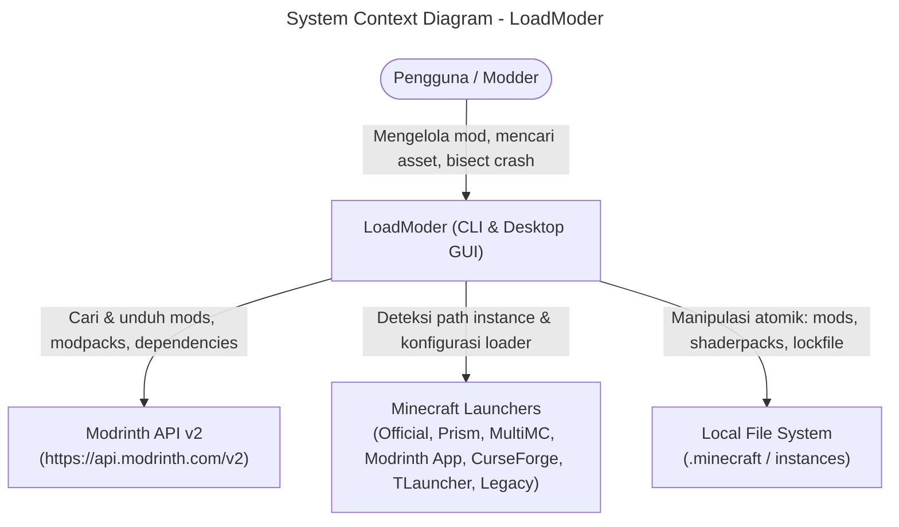
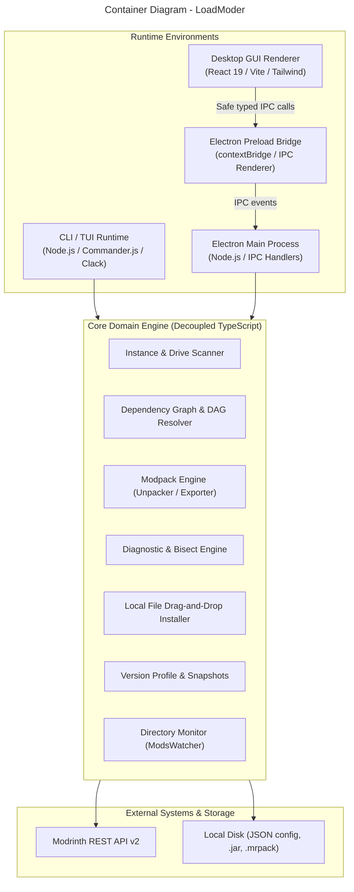
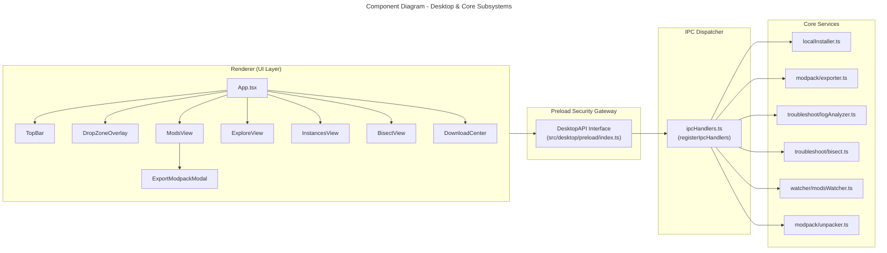
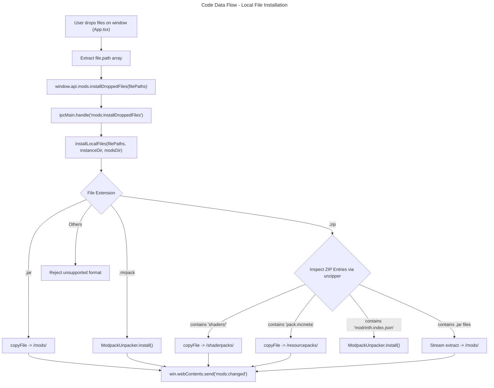
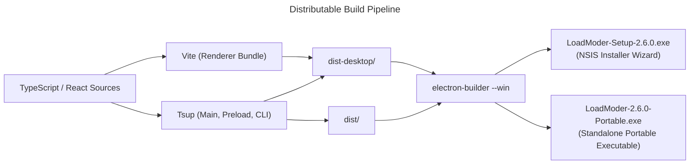

# C4 Architecture Specification: LoadModer

Dokumentasi arsitektur perangkat lunak LoadModer berdasarkan standar **C4 Model** (Context, Container, Component, Code) yang mencakup CLI/TUI dan Desktop GUI Application.

---

## Level 1: System Context

Diagram Konteks Sistem menggambarkan posisi LoadModer dalam ekosistem pengelolaan mod Minecraft dan hubungannya dengan aktor eksternal.

---

## Level 2: Container Diagram

Diagram Kontainer memetakan boundary antara runtime CLI, aplikasi Desktop Electron, Core Domain Logic, dan penyimpanan lokal.

---

## Level 3: Component Diagram (Desktop Subsystem)

Diagram Komponen memperlihatkan arsitektur internal modul desktop dan jembatan ke logika domain murni.

---

## Level 4: Code Diagram & Key Abstractions

### 1. Drag-and-Drop Installation Pipeline

### 2. Modul Domain Utama

#### `installLocalFiles(filePaths, instanceDir, modsDir, unpacker?)`
- **Lokasi**: [src/core/instance/localInstaller.ts](file:///c:/Users/DELL/Downloads/LoadModer/src/core/instance/localInstaller.ts)
- **Tanggung Jawab**: Memeriksa header dan entri berkas secara in-memory untuk menentukan klasifikasi asset (mod, shader, resourcepack, atau modpack), kemudian menyalin atau mengekstrak berkas secara aman tanpa risiko path traversal.
- **Keluaran**: `Promise<InstalledLocalResult[]>`

#### `ModpackExporter.exportModpack(opts)`
- **Lokasi**: [src/core/modpack/exporter.ts](file:///c:/Users/DELL/Downloads/LoadModer/src/core/modpack/exporter.ts)
- **Tanggung Jawab**: Mengompilasi mod yang aktif dan file konfigurasi menjadi bundle `.mrpack` (dengan `modrinth.index.json` dan hash SHA-512) atau `.zip` mandiri.
- **Keluaran**: `Promise<ModpackExportResult>`

#### `logAnalyzer.analyzeLog(logContent)`
- **Lokasi**: [src/core/troubleshoot/logAnalyzer.ts](file:///c:/Users/DELL/Downloads/LoadModer/src/core/troubleshoot/logAnalyzer.ts)
- **Tanggung Jawab**: Melakukan pattern-matching berbasis regex deterministik terhadap crash report atau latest.log Minecraft untuk mengidentifikasi penyebab kegagalan dan mod yang bermasalah.
- **Keluaran**: `Promise<LogAnalysisResult>`

#### `BisectRunner`
- **Lokasi**: [src/core/troubleshoot/bisect.ts](file:///c:/Users/DELL/Downloads/LoadModer/src/core/troubleshoot/bisect.ts)
- **Tanggung Jawab**: Binary search engine untuk membagi mod aktif menjadi subset uji guna mengisolasi mod penyebab crash dalam $\mathcal{O}(\log N)$ langkah.
- **Keluaran**: State tracking dengan persistensi aman ke `bisect_state.json`.

---

## Packaging & Distributables Pipeline

